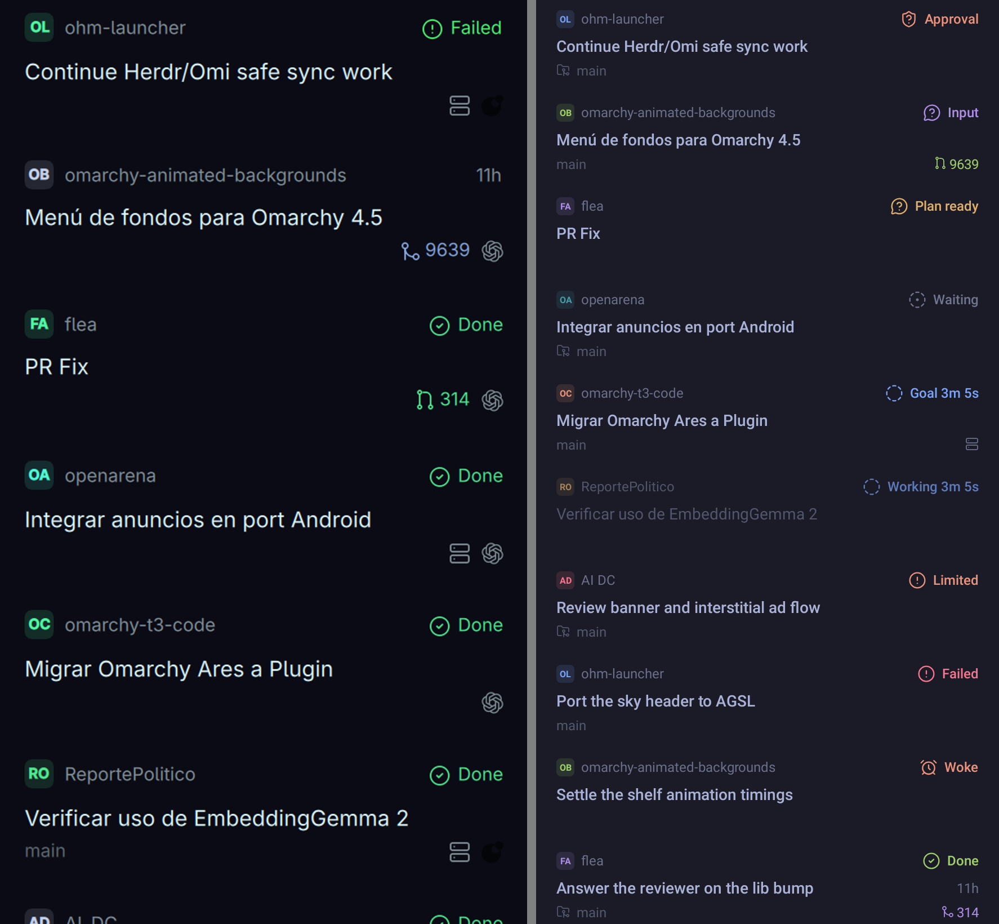
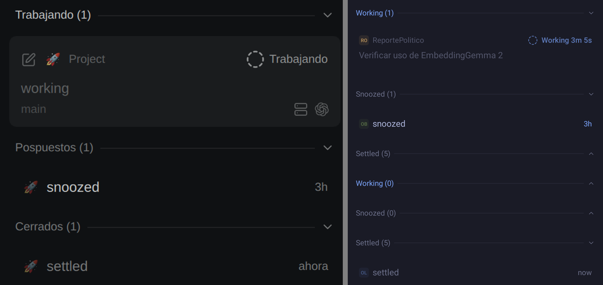
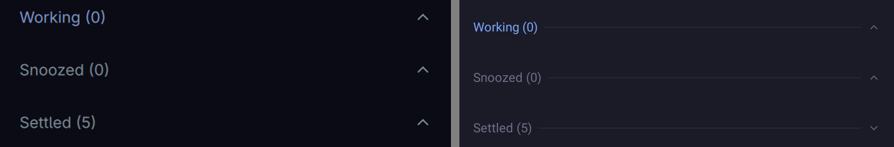
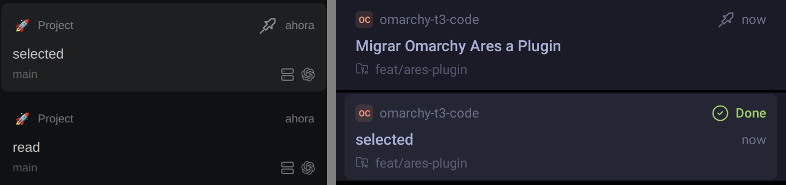
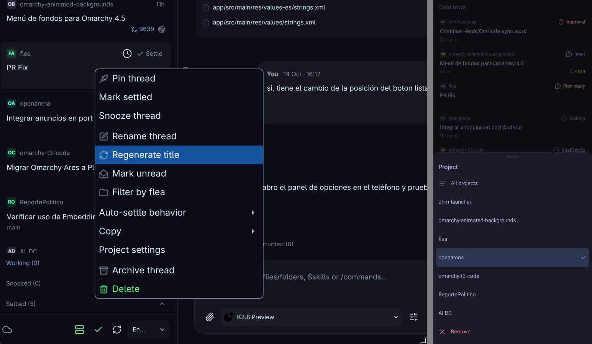
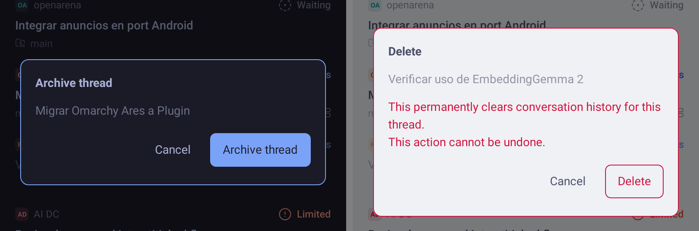
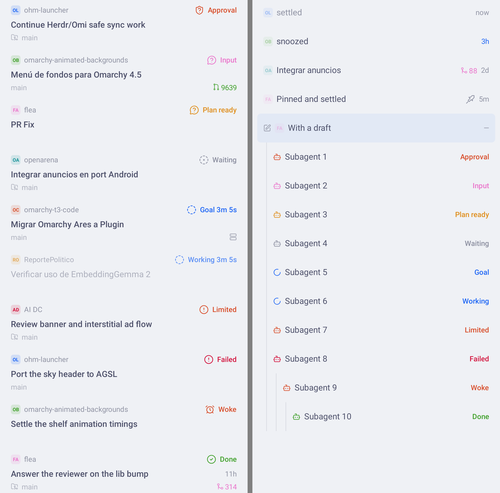

# UI-1e: the component kit against ot3

The kit's goldens (`app/src/test/snapshots/CatalogScreenshotTest/`, 411 × 891 dp at xhdpi,
motion Off) next to ot3's captures. ot3 is on the left of each crop, Android on the right.
The captures use a green theme and Spanish or English data, so compare structure, colour
roles and proportions, not pixels or words (UI_SPEC 5). Both are about 2 px per ot3 px /
dp, so the crops are close to scale.

| Crop | ot3 source | Android golden |
|---|---|---|
|  | `ot3-sidebar-and-thread.png`, card rows | `kit-rows-card.tokyo-night` |
|  | `ot3-timeline-shelves-composer.png`, shelves | `kit-shelves.tokyo-night` |
|  | `ot3-sidebar-and-thread.png`, collapsed shelves | `kit-shelves.tokyo-night` |
|  | `ot3-timeline-shelves-composer.png`, selected and pinned cards | `kit-rows-card-variants.tokyo-night` (pinned, selected) |
|  | `ot3-sidebar-and-thread.png`, search row icons | `kit-tooltip.tokyo-night` |
|  | `ot3-thread-context-menu.png` (a popup menu) | `kit-sheet.tokyo-night` (menus become sheets, rule 1) |
|  | — (ot3's dialog is not in the captures; built from `T3ThreadRow.qml:411-427`) | `kit-dialog.tokyo-night`, `kit-dialog-destructive.catppuccin-latte` |
|  | — | `kit-rows-card` and `kit-rows-slim`, catppuccin-latte |

## Colour roles, sampled

Exact pixel matches of the token value (docs/ui/tokens.md section 1) inside the element,
counted on the goldens:

| Golden | Element | Token | Pixels |
|---|---|---|---|
| rows-card, tokyo-night | background / title / project name | `#1a1b26` / `#a9b1d6` / `#6c708a` | 225 / 1956 / 317 |
| rows-card, tokyo-night | Approval, Input, Plan ready, Goal, Failed, Done | warning `#eb927b`, input `#ad8ee6`, waiting `#e0af68`, working `#7aa2f7`, failed `#f7768e`, done `#9ece6a` | 484, 359, 561, 487, 400, 335 |
| rows-card, tokyo-night | PR open / merged | done `#9ece6a` / input `#ad8ee6` | 147 / 115 |
| rows-card, catppuccin-latte | background, title, dim, Failed, Done | `#eff1f5`, `#4c4f69`, `#9295a5`, `#d20f39`, `#40a02b` | 225, 1978, 329, 398, 342 |
| rows-card-variants | draft / selected fill | rowDraft `#202333` · `#e2e9f5`; rowSelected `#252633` · `#e3e5ea` | all |
| controls, tokyo-night | primary fill, switch on, switch off, field, field border, destructive fill | `#7aa2f7`, `#7aa2f7`, `#2f3240`, `#20212d`, `#2e303f`, `#f7768e` | all |
| controls, tokyo-night | copied / copy failed icon | accent / failed | 56 / 205 |
| controls, catppuccin-latte | primary fill, switch off, field | `#1e66f5`, `#d7d9e0`, `#e8ebef` | all |
| controls, tokyo-night | settings card, divider | changesCard `#1e1f2a`, divider `#272836` | 4, 1466 |
| shelves, tokyo-night | Working label, Snoozed label, rule, countdown | working, dim, divider, working | 271, 250, 1080, 64 |
| badges, tokyo-night | working / done / waiting pills, live / stale dot | `#7aa2f7`, `#9ece6a`, `#e0af68`, accent, failed | 514, 524, 556, 88, 88 |
| sheet | scrim, background, top hairline | `#0d0d13` (black 0.5 over background), `#1a1b26`, cardBorder `#2b2d3b` · `#dbdee4` | all |
| dialog | border | accent `#7aa2f7`; destructive failed `#f7768e` | all |
| tooltip | border | cardBorder `#2b2d3b` | 1277 |

## Differences from ot3 left open

- **Provider icon** at the end of a card's third line (`T3ThreadRow.qml:321`) is not drawn:
  `Ot3Icons` has no provider marks yet (UI-1b decision). The remote-machine icon is.
- **Row auras** (working comet, input glints, change burst) are out of v1 (UI_SPEC 3.7).
- **Chip and text proportion:** text follows the 7/6 rule (caption 12 sp) while the chip
  stays 16 dp, so the chip looks a little smaller next to the project name than in ot3.
- **Title weight:** the capture predates the pinned code; ot3's code draws active titles
  Medium and receding ones Regular in `dim`, which is what the kit does.
- **Hover-only pieces** have touch equivalents elsewhere: settle / snooze / discard buttons
  and the hover card become swipe actions and the long-press sheet (UI-1d); PR previews on
  hover become the Thread pull requests sheet.
- **Shelf headers** get a 48 dp target and a pressed fill (ot3 has no hover fill on them).
- **Sheet stops:** the partial stop is Material's half height; UI_SPEC 2.2's per-sheet
  fractions wait for custom detents (docs/DECISIONS.md, 2026-10-25, UI-1e).
- **Tooltip colours** use ot3's popup look; Omarchy's tooltip palette is not imported.
- **Dialog capture:** the window capture shows ot3's Archive dialog; the Rename dialog,
  whose field keeps Robolectric from going idle in a dialog window, is in
  `kit-dialog-cards` as an inline card.
- **Spinner and activity shimmer** are drawn at rest (motion Off) in the goldens; their
  timing is covered by `KitModelsTest` against ot3's `WorkIndicator.qml` and `activity.frag`.
