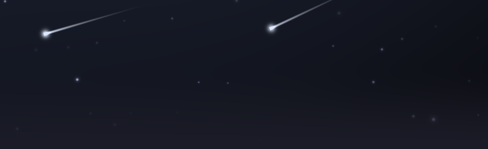
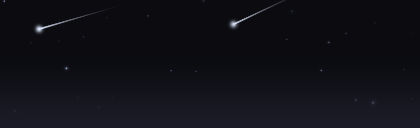
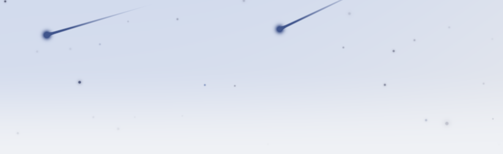
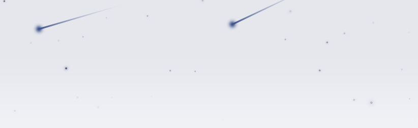
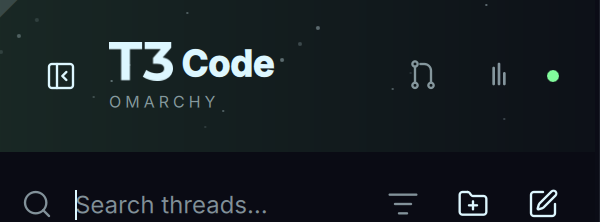

# UI-1c: the sky header against ot3

One frame (411 × 126 dp at density 2, drift 640 dp, clock 21.3 s, energy 1, so two comets
in flight), rendered without a device because the emulator is down:

- `*-agsl.png`: the real `STARFIELD_AGSL`, compiled and drawn by Skia's SkSL runtime
  (`scripts/check-starfield-agsl.py`), over the theme background.
- `*-canvas.png`: the API < 33 fallback's `SkyCanvasPlan`, rasterised on the JVM by
  `SkyCanvasPlanTest`. Compose draws the same plan with the same gradient stops.
- `ot3-header-crop.png`: the header of `../../reference/ot3-sidebar-and-thread.png` (green
  theme, ot3 at about 1.2× scale; it predates the pinned code, which adds the fade).

| | AGSL (API 33+) | Canvas (API 24–32) |
|---|---|---|
| tokyo-night (dark) |  |  |
| catppuccin-latte (light) |  |  |

ot3: 

What to compare (UI_SPEC 5: structure, colour roles, proportions):

- Base: dark sky = background ÷ 2.4 (tokyo-night `#0b0b10`), light sky = background
  tinted 6 % towards the foreground (catppuccin-latte `#e5e7ed`); solid behind the 62 dp
  brand row, then fading to the page background by the bottom edge.
- Stars: sparse points on three grids, a few tinted towards the accent; dark ink on the
  light sky with 1.7× gain.
- Nebula (AGSL only): the accent rises towards the top left, as the green haze in ot3.
- Comets: white with a quarter of accent on dark skies, foreground ink on light ones;
  right to left and downwards, tail 94 dp here (0.22 × diagonal).
- AGSL and the JVM reference of the same shader differ by 0.007 / 255 on average (one
  pixel over 8 / 255, a float rounding at a star edge).
